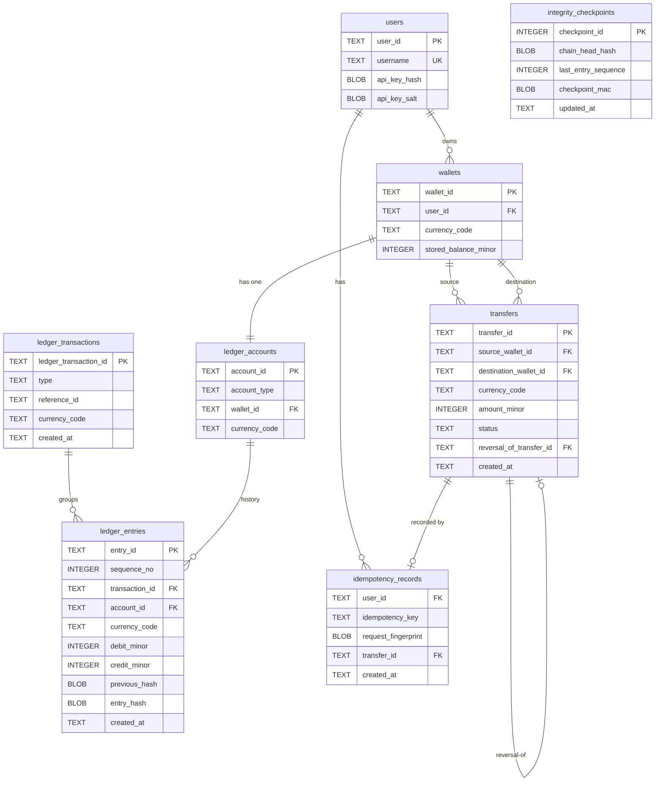

# Architecture Overview — Financial Ledger & Digital Wallet API

- **Project:** Financial Ledger & Digital Wallet API
- **Document:** `docs/architecture.md`
- **Source baseline:** SRS v1.3
- **Status:** Accepted — aligned with ADR-001 through ADR-006 (2026-11-25)
- **Scope:** System context, component structure, data flow, ER diagram, and
  sequence diagrams. Does not cover detailed endpoint schemas (see
  `docs/design/`) or implementation code.

---

## 1. System context

The application is a backend REST API for a software engineering course. It
simulates a multi-currency digital wallet. It never holds real money.

```
┌────────────────────────────────────┐
│          HTTP Client               │
│  (curl / Postman / test suite)     │
└───────────────┬────────────────────┘
                │ HTTPS / HTTP
                ▼
┌────────────────────────────────────┐
│   Financial Ledger & Wallet API    │
│   Spring Boot 4.1.2 / Java 21      │
│                                    │
│   Controllers → Services →         │
│   Repositories → SQLite (JDBC)     │
└───────────────┬────────────────────┘
                │ JDBC
                ▼
┌────────────────────────────────────┐
│   SQLite database file             │
│   ./data/financial_ledger.db       │
│   WAL mode; foreign keys ON        │
└────────────────────────────────────┘
```

There is no external dependency, message queue, or separate auth service.
All state lives in a single SQLite file.

---

## 2. Technology choices

| Item | Decision | Rationale |
|---|---|---|
| Language | Java 21 | SRS §2.5 |
| Framework | Spring Boot 4.1.2 | SRS §2.5 |
| Database | SQLite | SRS §2.5; see ADR-001 |
| DB access | JDBC (no ORM) | SRS §2.5; avoids ORM auto-flush surprises in concurrent transactions |
| Journal mode | WAL | SRS §6.1; see ADR-003 |
| Write lock | `BEGIN IMMEDIATE` | FR-3.2; see ADR-003 |
| Money storage | 64-bit integer minor units | SRS §6.1; see ADR-001, [[monetary-precision]] |
| Auth | Custom `X-User-API-Key` header | SRS §3.2; see ADR-002 |
| Admin auth | `X-Admin-API-Key` from config | SRS §3.2; see ADR-002 |
| Idempotency | User-scoped `Idempotency-Key` header | FR-2.5; see ADR-006 |
| Integrity | SHA-256 hash chain + HMAC-SHA-256 checkpoint | FR-4.3; see ADR-004 |

---

## 3. Application layers

```
┌─────────────────────────────────────────────────────┐
│  Controller layer                                   │
│  Receives HTTP; validates path params; delegates    │
│  UserController, WalletController, LedgerController │
│  TransferController, AdminController                │
└───────────────────────┬─────────────────────────────┘
                        │
┌───────────────────────▼─────────────────────────────┐
│  Service layer                                      │
│  Business rules, auth, ownership, concurrency       │
│  UserService, ApiKeyService, WalletService          │
│  TransferService, AdminService, LedgerHistoryService│
│  IntegrityService, ReconciliationService            │
└───────────────────────┬─────────────────────────────┘
                        │
┌───────────────────────▼─────────────────────────────┐
│  Repository layer                                   │
│  Parameterised JDBC; BEGIN IMMEDIATE for writes     │
│  UserRepository, WalletRepository                  │
│  LedgerAccountRepository, LedgerEntryRepository    │
│  TransferRepository, IdempotencyRepository         │
│  IntegrityCheckpointRepository                     │
└───────────────────────┬─────────────────────────────┘
                        │
┌───────────────────────▼─────────────────────────────┐
│  SQLite database (WAL mode, FK enforcement)         │
└─────────────────────────────────────────────────────┘
```

**Security filter:** A Spring `SecurityFilterChain` bean intercepts every
request. It passes `GET /health` and `POST /users` without credentials.
All other routes require a valid `X-User-API-Key` or `X-Admin-API-Key` header.
The filter never uses Spring's default auto-configured `InMemoryUserDetailsManager`
or HTTP Basic auth (see ADR-002, NFR-6).

---

## 4. API endpoints

| Method | Path | Auth required | SRS ref |
|---|---|---|---|
| GET | `/health` | None | SRS §3.3 |
| POST | `/users` | None | FR-1.1 |
| POST | `/users/{username}/wallets` | X-User-API-Key | FR-1.2 |
| GET | `/users/{username}/wallets/{currencyCode}` | X-User-API-Key | FR-1.3 |
| GET | `/wallets/{walletId}` | X-User-API-Key | FR-1.3 |
| GET | `/wallets/{walletId}/ledger-entries` | X-User-API-Key | FR-4.7 |
| POST | `/admin/funding` | X-Admin-API-Key | FR-1.4 |
| POST | `/transfers` | X-User-API-Key | FR-2.1 |
| GET | `/transfers/{transferId}` | X-User-API-Key | FR-2.1 |
| POST | `/transfers/{transferId}/reversal` | X-User-API-Key | FR-4.5 |
| GET | `/admin/reconciliation` | X-Admin-API-Key | FR-5 |
| GET | `/admin/ledger-integrity` | X-Admin-API-Key | FR-4.3 |

The `GET /health` endpoint returns `{"status":"UP"}` with `200 OK` and requires
no authentication. It is public by SRS §3.3.

---

## 5. Entity-Relationship diagram



> **Notes on the ER diagram:**
> - The `users` table uses 4 columns (`user_id`, `username`, `api_key_hash`,
>   `api_key_salt`), plus a case-insensitive unique index `uq_users_username_lower`
>   on `LOWER(username)`. `username` is the human-readable identifier used for
>   registration and username-based wallet routes, while `user_id` (UUID) remains
>   the internal primary key and the public lookup identifier embedded in `X-User-API-Key`.
>   See ADR-002 for the resolution of the conflicting `api_key_id` column proposed
>   in `database-ledger-design.md`.
> - The `ledger_accounts.wallet_id` is `NULL` for the system funding account
>   (`account_type = 'SYSTEM_FUNDING'`).
> - `integrity_checkpoints` has at most one row (`checkpoint_id = 1`).

---

## 6. Sequence diagrams

### 6.1 User registration

```
Client                  UserController         UserService          UserRepository
  │                           │                     │                     │
  │── POST /users ────────────▶                     │                     │
  │                           │── register() ───────▶                     │
  │                           │                     │── generateUserId()  │
  │                           │                     │── generateApiKey()  │
  │                           │                     │── hashKey(salt)     │
  │                           │                     │── insert(user) ─────▶
  │                           │                     │◀── OK ──────────────│
  │◀── 201 {userId, apiKey} ──│◀── {userId, apiKey} │                     │
```

The plain API key is returned once and never stored.

---

### 6.2 Wallet creation

```
Client            WalletController      ApiKeyService      WalletService    DB
  │                     │                    │                   │            │
  │─ POST /users/{username}/wallets ─────────▶│                   │            │
  │  X-User-API-Key                          │── verifyKey() ────▶            │
  │                     │                    │◀─ userId ─────────│            │
  │                     │── createWallet() ──────────────────────▶            │
  │                     │                    │  check userId == pathId        │
  │                     │                    │  check currency supported      │
  │                     │                    │  check no duplicate wallet     │
  │                     │                    │── BEGIN IMMEDIATE ─────────────▶
  │                     │                    │── INSERT wallet ───────────────▶
  │                     │                    │── INSERT ledger_account ───────▶
  │                     │                    │── COMMIT ──────────────────────▶
  │◀─ 201 {walletId} ───│◀──────────────────│                                │
```

---

### 6.3 Admin funding (double-entry)

```
Client              AdminController     AdminService          DB
  │                       │                  │                 │
  │─ POST /admin/funding ─▶                  │                 │
  │  X-Admin-API-Key       │── fund() ───────▶                 │
  │                        │                 │── BEGIN IMMEDIATE ──▶
  │                        │                 │── SELECT systemFundingAccount
  │                        │                 │── SELECT walletLedgerAccount
  │                        │                 │── INSERT LedgerTransaction
  │                        │                 │── INSERT LedgerEntry (debit system)
  │                        │                 │── INSERT LedgerEntry (credit wallet)
  │                        │                 │── UPDATE wallet stored_balance
  │                        │                 │── UPDATE integrity_checkpoints
  │                        │                 │── COMMIT ───────────▶
  │◀─ 201 {ledgerTxId} ───│◀─────────────────│                 │
```

---

### 6.4 Transfer with idempotency

```
Client           TransferController    TransferService          DB
  │                    │                     │                   │
  │─ POST /transfers ──▶                     │                   │
  │  X-User-API-Key    │── transfer() ───────▶                   │
  │  Idempotency-Key   │                     │── verify API key  │
  │                    │                     │── BEGIN IMMEDIATE ▶
  │                    │                     │── SELECT idempotency record
  │                    │                       if exists and same fingerprint:
  │                    │                     │── COMMIT; return cached result
  │                    │                       if exists and different fingerprint:
  │                    │                     │── COMMIT; return 409
  │                    │                       if new:
  │                    │                     │── check source ownership
  │                    │                     │── check currency match
  │                    │                     │── check source balance ≥ amount
  │                    │                     │── INSERT Transfer
  │                    │                     │── INSERT LedgerTransaction
  │                    │                     │── INSERT LedgerEntry (debit source)
  │                    │                     │── INSERT LedgerEntry (credit dest)
  │                    │                     │── UPDATE both wallet balances
  │                    │                     │── INSERT IdempotencyRecord
  │                    │                     │── UPDATE integrity_checkpoints
  │                    │                     │── COMMIT ──────────▶
  │◀─ 201 {transferId}─│◀────────────────────│                   │
```

If `BEGIN IMMEDIATE` returns `SQLITE_BUSY`, the service retries up to the
configured limit and then returns `503 Service Unavailable` with a
`Retry-After` header. See ADR-003 and `docs/design/transfer-and-concurrency-design.md`.

---

### 6.5 Concurrent transfer safety

```
Request A (BEGIN IMMEDIATE) ────────────── holds write lock
Request B (BEGIN IMMEDIATE) ──────────────────── SQLITE_BUSY → retry → ...
                                                  (blocked until A commits)
Request A (check balance, debit, credit, COMMIT)
Request B (BEGIN IMMEDIATE succeeds) ─────────────────────────────────────
Request B (checks updated balance; may fail with insufficient funds)
```

SQLite serialises writers. The write lock is taken before the balance check
to prevent lost updates. See [[race-conditions]] and ADR-003.

---

### 6.6 Reversal

```
Client           TransferController    TransferService          DB
  │                    │                     │                   │
  │─ POST /transfers/{id}/reversal ──────────▶                   │
  │  X-User-API-Key    │                     │── verify API key  │
  │                    │                     │── BEGIN IMMEDIATE ▶
  │                    │                     │── SELECT original Transfer
  │                    │                     │── verify: caller owns source wallet
  │                    │                     │── verify: status == COMPLETED
  │                    │                     │── verify: not already reversed
  │                    │                     │── verify: not itself a reversal
  │                    │                     │── verify: dest has enough funds
  │                    │                     │── INSERT reversal Transfer
  │                    │                     │── INSERT LedgerTransaction
  │                    │                     │── INSERT LedgerEntry (debit dest←source)
  │                    │                     │── INSERT LedgerEntry (credit source)
  │                    │                     │── UPDATE both wallet balances
  │                    │                     │── UPDATE original transfer status → REVERSED
  │                    │                     │── UPDATE integrity_checkpoints
  │                    │                     │── COMMIT ──────────▶
  │◀─ 201 {reversalId}─│◀────────────────────│                   │
```

---

## 7. Security model

| Concern | Mechanism |
|---|---|
| User identity | `X-User-API-Key` header; server verifies salted hash (ADR-002) |
| Admin identity | `X-Admin-API-Key` read from environment variable; not stored in DB |
| Ownership | Service layer: `authenticatedUserId == wallet.user_id` |
| Input validation | Bean Validation + parameterised SQL |
| Secret exposure | API key never logged; not in error responses; not committed |
| Ledger tampering | SHA-256 hash chain + HMAC-SHA-256 checkpoint (ADR-004) |
| Concurrency | `BEGIN IMMEDIATE` serialises writers (ADR-003) |

---

## 8. References

- SRS v1.3: `brain/srs/Financial_Ledger_Digital_Wallet_SRS_v1.3.pdf`
- Design documents: `docs/design/`
- ADRs: `docs/adr/`
- Research notes: `brain/resources/`
  - [[double-entry-accounting]]
  - [[sqlite-acid-transactions-final]]
  - [[sqlite-wal-mode]]
  - [[race-conditions]]
  - [[spring-transactional]]
  - [[api-idempotency-keys]]
  - [[immutable-audit-trails-and-reversals]]
  - [[ledger-reconciliation]]
  - [[monetary-precision]]
  - [[integration-testing-and-rollback]]
